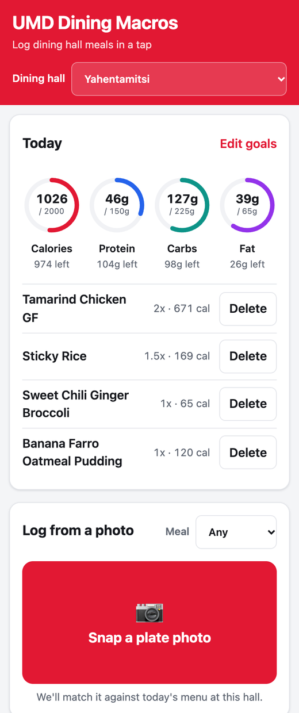
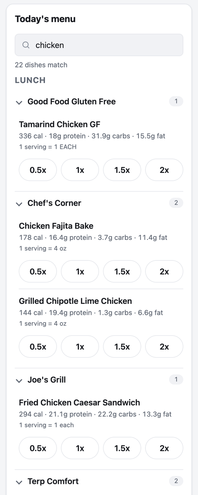
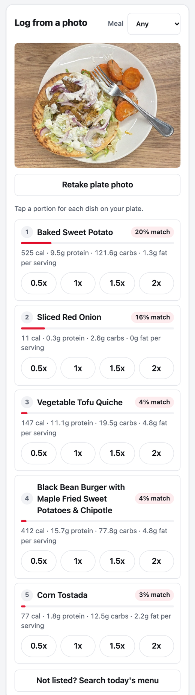

# UMD Dining Macro Tracker

A web app that helps University of Maryland students track macros in the dining halls. Every day it pulls the menu and the nutrition facts UMD publishes for each dish from [nutrition.umd.edu](https://nutrition.umd.edu), so a student can log a meal in a couple of taps instead of typing in macros by hand.

Students can also **snap a photo of their plate** and get the app's best guesses for which dishes are on it. General calorie apps have to recognize any food in the world. This one only has to choose from **today's menu at one dining hall**, which is a much smaller problem.

## Screenshots

| Daily dashboard | Today's menu | Log from a photo |
|:---:|:---:|:---:|
|  |  |  |
| Macro rings against editable daily goals, plus everything logged today | Every dish grouped by meal and station, with search and a portion stepper | Top 5 guesses from today's menu, each loggable with the same portion stepper |

*Phone layout (390px wide). The app also supports desktop and dark mode.*

## Features

- Today's menu for **South Campus** and **Yahentamitsi**, grouped by meal and station, with search
- Calories, protein, carbs and fat for every dish that has a UMD nutrition label
- A − / + portion stepper (0.5x–3x in quarter steps) with live calories and macros; on a photo it starts at CLIP's small / medium / large portion guess
- A daily dashboard with macro rings, editable goals, and the dishes you logged (with delete)
- **Log from a photo:** returns the top 5 guesses from today's menu. If the right dish is missing, you can search the menu for it. Each photo, along with the dishes the student logs from it, is saved as labeled training data.
- No accounts: each phone gets a random device ID. A privacy notice appears before the camera opens, and photo metadata (such as GPS location) is removed before a photo is saved.

## Tech stack

| Layer | Tech |
|---|---|
| Scraper | Python, `requests`, BeautifulSoup |
| Database | SQLite |
| Backend | FastAPI, Pydantic, Uvicorn |
| Frontend | React 19 + Vite, plain CSS (design tokens, dark mode, no UI kit) |
| ML | PyTorch + Hugging Face Transformers, CLIP (`openai/clip-vit-base-patch32`) |
| Tests | pytest, Vitest + Testing Library |
| Packaging | Docker (two-stage build, CPU-only torch) |

```
nutrition.umd.edu ──► Scraper ──► SQLite ──► FastAPI ──► React app
   (HTML pages)      (Python)    database    (JSON API)  (browser)
                                                │
                                          CLIP recognizer
                                          (plate photos)
```

## How the ML works

The recognizer uses **zero-shot CLIP, restricted to the dishes on that day's menu.**

1. **Candidates come from today's menu.** When a photo is uploaded, the API looks up the dishes being served today at the chosen hall (and meal, if one is picked) that have nutrition info, usually a few hundred names. That list is the whole set of possible answers.
2. **Each dish name becomes a text prompt**, `"a photo of {name}, a dining hall dish"`. This wording was picked by comparing three templates on hand-labeled plates (results in `ml/eval_history.csv`).
3. **CLIP scores the photo against every prompt.** CLIP was trained on hundreds of millions of image–caption pairs to place matching images and text close together. A softmax turns the similarity scores into probabilities over today's dishes.
4. **The top 5 are shown as guesses.** The student taps a portion for each correct one, or searches the menu if a dish is missing.

**Why this works without training:** "zero-shot" means CLIP has never seen a UMD dish labeled as such. It only compares the photo against the dish names. Limiting the choices to today's menu is the key idea: it turns "recognize any food in the world" into "pick from today's list", and the guesses automatically follow tomorrow's menu without retraining.

**Measuring it:** a plate usually holds several dishes, so plain accuracy doesn't fit. `ml/evaluate.py` reports **top-1** (is the #1 guess on the plate?), **top-3**, and **recall@5** (the share of the plate's dishes found in the top 5, which matches the UI). On the first small hand-labeled set (3 plates), the chosen prompt scored 0.67 top-1 and 0.33 recall@5, so there's plenty of room to improve. The screenshot above shows a typical miss: the carrots were read as "Baked Sweet Potato", while the red onion (#2) is correct.

**The training-data loop:** every photo is saved with the dishes the student actually logged from it. That pairing is a free label. `ml/export_training_data.py` turns these into a CSV for fine-tuning later.

## Run it with Docker

The image contains everything: the FastAPI server, CPU-only PyTorch, the CLIP weights (downloaded at build time so the server works offline) and the built React app. The database and photos live in a mounted `/data` folder, never in the image.

```bash
# Build (~3.6 GB image; leave ~10 GB free disk space for the build)
docker build -t macros .

# Fill the database with today's menus (polite 2s delay between requests, so the first run takes ~10 min)
docker run --rm -v "$PWD/docker-data:/data" macros python -m scraper.daily_scrape

# Start the app at http://localhost:8080
docker run -p 8080:8080 -v "$PWD/docker-data:/data" macros
```

<details>
<summary>Running without Docker (for development)</summary>

You need Python 3.12+ and Node.js.

```bash
python3 -m venv .venv
.venv/bin/pip install -r requirements.txt
.venv/bin/python -m scraper.daily_scrape          # or: --date 2026-10-14
.venv/bin/uvicorn api.main:app --reload            # API docs at http://127.0.0.1:8000/docs

cd frontend && npm install && npm run dev          # http://localhost:5173
```

The Vite dev server forwards `/api/*` to FastAPI, so no CORS setup is needed. The first photo downloads CLIP (~600 MB).
</details>

## Tests

**288 tests: 198 backend (pytest) and 90 frontend (Vitest).** All pass.

```bash
.venv/bin/python -m pytest          # scraper, database, API, recognizer, evaluation, Docker config
cd frontend && npx vitest run       # React components and API client
```

The tests never contact the UMD site and never download CLIP. Scraper tests use saved copies of real pages (`tests/fixtures/`), API tests use a temporary database, and recognizer tests replace CLIP with a small fake scorer.

## Project layout

| Folder | What's in it |
|---|---|
| `scraper/` | Downloads menu and nutrition-label pages, parses them, and saves them to the database |
| `db/` | SQLite schema and queries. Logged meals copy the macros, so a later re-scrape can't change past totals |
| `api/` | FastAPI routes: `/halls`, `/menu`, `/items`, `/meals`, `/summary`, `/recognize`, `/health` |
| `ml/` | CLIP recognizer, photo storage (removes metadata), evaluation and training-data export |
| `frontend/` | React app; all backend calls go through `src/api.js` |

Every design choice, including what was rejected and why, is recorded in [DECISIONS.md](DECISIONS.md).

## Status

- [x] **Scraper:** daily menus and nutrition labels for two dining halls
- [x] **Backend API:** menu, nutrition, meal logging and daily totals
- [x] **Frontend:** menu browsing, portion logging, macro dashboard, phone layout and dark mode
- [x] **ML v1:** zero-shot CLIP photo guesses, an evaluation script, and training-data collection
- [x] **Deploy prep:** per-device data, privacy notice, photo metadata removal, a daily photo limit, and a production Docker image

## Future work

- **Portion estimation:** dining hall plates and bowls are a standard size, so the plate can serve as a scale reference to estimate how much of each dish is on it, instead of today's rough small / medium / large guess.
- **Fine-tuning CLIP:** train on the photos students have labeled by logging, and grow the hand-labeled evaluation set so the gains can be measured.
- **Cloud hosting:** deploy the Docker image (Fly.io is the leading option), add a scheduled daily scrape, and move to Postgres if the app needs more than one server.
- **More schools:** the rest of UMD's dining halls first, then other universities. Only the scraper is specific to UMD's site.
